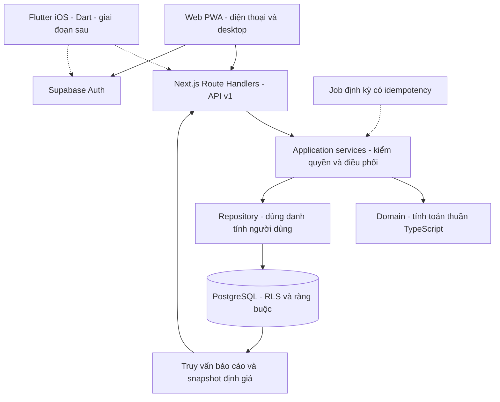

# Kiến trúc và công nghệ

**Hiện trạng 17/10/2026:** web Next.js có landing công khai, Auth email, API v1 cho Thu nhập/Chi tiêu/Tiết kiệm và migrations PostgreSQL/RLS. Các mô tả P0 và endpoint dự kiến bên dưới là nền định hướng lịch sử, không phải danh sách chức năng đang thiếu của ba module đã triển khai.

## Trang công khai và kiểm soát truy cập

- Root layout giữ font, token, user provider và PWA. Route group `(public)` chứa `/` và `/login`; `(app)` giữ URL hiện có với sidebar, Privacy Mode và metadata noindex.
- Mỗi page ứng dụng await `pageAccess()` trước khi render. `pageSession()` xác minh qua Supabase `getUser`, chỉ cache trong một lượt render; không dựa vào cookie claim hoặc layout để cấp quyền.
- Proxy refresh cookie cho trang và API, đặt private/no-store. Chỉ request API có Authorization mới bỏ qua refresh cookie; API tự xác minh Bearer và owner/RLS.
- Phiên thiếu/hết hạn chuyển `/login?next=...`; whitelist route dùng chung với catalog, mặc định `/overview`. Auth gián đoạn hiện retry, không coi là logout. `/` luôn công khai.
- Landing HTML và ảnh Open Graph không chờ Auth trong proxy; avatar được xác minh trong trình duyệt, để nội dung công khai vẫn đọc được khi Auth gián đoạn.
- Landing preview là client component với dữ liệu mẫu cố định; không import workspace hoặc gọi API tài chính. Tài khoản công khai dùng user provider/menu hiện có, tách khỏi dữ liệu preview.
- Metadata chia sẻ có ảnh Open Graph sinh bằng Next ImageResponse. App và login noindex; service worker chỉ cache offline.html, PWA mở /overview sau xác thực.
- Catalog là nguồn module/status dùng chung; tài liệu và preview được rà soát cùng thay đổi theo AGENTS.md. Xem [đặc tả landing](features/landing.md).

**Module Chi tiêu đã có source:** Supabase SSR/Auth, API v1, Zod, Postgres.js và transaction/RLS; native form/dialog, biểu đồ HTML/SVG, Vitest/Playwright. Connection server dùng role expense_api và JWT claims theo owner đã xác minh. Chi tiết triển khai và khác biệt so với các công nghệ còn dự kiến bên dưới nằm ở [đặc tả Chi tiêu](features/expenses.md). Mức xác minh cloud theo từng module được ghi riêng trong [validation](07-validation.md); migration Tiết kiệm chưa áp dụng trên cloud.

## Quyết định chính

Dùng một codebase web và backend theo module, tránh tách microservice ở quy mô cá nhân. Tách nghiệp vụ tài chính khỏi framework; cung cấp HTTP API có phiên bản để PWA và iOS dùng chung. Stack bên dưới phân biệt công nghệ đã dùng trong source và những lựa chọn chỉ bổ sung khi cần.

## Stack theo nhu cầu

| Lớp | Công nghệ | Lý do chọn | Trạng thái |
| --- | --- | --- | --- |
| Runtime | Node 22 LTS, npm + lockfile | Có runtime phù hợp sẵn trên máy; kiểm tra nhất quán local/CI/cloud | Đã dùng local |
| Web và API | Next.js App Router + React + TypeScript strict | Routing, rendering và HTTP API trong cùng source; dễ triển khai và tách service về sau | Đã triển khai landing, Auth và ba module |
| Styling | Tailwind CSS 4 + CSS semantic tokens | Giao diện responsive, theme và tái sử dụng style | Đã cài; shell dùng CSS tokens |
| Components | shadcn/ui, bổ sung khi có dialog/form/table thực tế | Sở hữu source component và chuẩn hóa hành vi truy cập | Chưa cài |
| Icon | Lucide React | Cùng một bộ SVG có nhãn đi kèm | Đã dùng |
| Forms | Native form/dialog + Zod | Schema kiểm tra client/server; chưa cần React Hook Form | Đã dùng |
| Biểu đồ/bảng | HTML/SVG và bảng có accessibility | Tương tác bàn phím, bảng thay thế, ít dependency | Đã dùng; Recharts/TanStack chưa cần |
| Số học | BigInt; số lượng vàng có scale cố định | Tránh mất chính xác từ float; API dùng decimal string | Đã triển khai |
| Database | PostgreSQL, Postgres.js và SQL migrations | Transaction, RLS và role expense_api | Source/local đã có; cloud theo module |
| Auth | Supabase Auth + `@supabase/ssr` cho web | Email/OTP, cookie refresh, page/API verification | Đã triển khai |
| Client dữ liệu | HTTP API v1 cho tài chính; Supabase SDK cho Auth | Server xác minh owner và áp RLS | Đã dùng |
| PWA | Manifest của Next.js + service worker giới hạn phạm vi | Bắt đầu nhẹ, offline fallback; hàng đợi offline bổ sung sau | Nền PWA đã dựng |
| Kiểm thử | Vitest, DB integration/RLS, Playwright | Kiểm công thức, transaction, quyền và tác vụ nhiều thiết bị | Unit, DB integration/RLS và browser local đã có |
| Deploy | Vercel + Supabase managed | Hạn chế việc tự vận hành server; preview riêng với production | Mới là kế hoạch |

Khóa phiên bản thực tế trong `package-lock.json`. Dùng TypeScript 5.9 cho bộ khung hiện tại; không tự động chuyển major theo npm latest. Các dependency chưa cần thiết được để ở trạng thái dự kiến.

## Ranh giới source khi mở rộng

- `src/app`: route web và `/api/v1`, chỉ chuyển request/response, không chứa công thức tài chính trong JSX.
- `src/features/<feature>`: component, form và view model của mỗi module.
- `src/domain`: kiểu và hàm thuần phía TypeScript; không import React/Next/Supabase/browser. Flutter sử dụng kết quả qua API, không import TypeScript trực tiếp.
- `src/application`: use case như `recordExpense`, `transferFunds`, `executeTrade`, kiểm quyền, idempotency và transaction boundary.
- `src/server`: session, repository và adapter DB; chỉ server được import.
- `supabase/migrations`: SQL có phiên bản, RLS, constraints và RPC nguyên tử.
- `tests`: bổ sung theo nghiệp vụ; dữ liệu giả, không dùng tài chính thật.

Trang `[module]` giữ bản đồ phạm vi cho module chưa triển khai; vẫn yêu cầu đăng nhập. Thu nhập, Chi tiêu và Tiết kiệm có route, domain, API và migrations riêng; quy tắc module còn lại tiếp tục được làm rõ theo đặc tả.

## Ghi dữ liệu và API cho iOS

Đề xuất `/api/v1/accounts`, `/transactions`, `/budgets`, `/funds`, `/goals`, `/trades`, `/valuations`, `/reports` và `/imports`. Đây là các hợp đồng mở rộng dự kiến. Hiện đã có `/api/v1/income`, `/api/v1/expenses` và `/api/v1/savings`, gồm preview/commands/reports theo module. Viết OpenAPI/schema request-response trước khi app iOS dùng API.

Web dùng session cookie được xác minh phía server; native về sau dùng bearer access token đã kiểm chứng issuer/audience/expiry. Không tin `owner_id` từ request. Mọi use case lấy chủ sở hữu từ danh tính đã xác thực, kiểm quan hệ tài khoản/tài sản thuộc cùng chủ.

Lệnh thay đổi tiền có idempotency key, payload fingerprint và version. Gửi lại cùng key/cùng payload trả lại kết quả cũ; cùng key/khác payload báo xung đột. Ghi nhiều bảng phải đi qua **một DB transaction/RPC**; không gọi nhiều request Supabase độc lập rồi hy vọng tất cả cùng thành công. Không dùng service-role key cho request tài chính thông thường.

React Server Components có thể đọc trực tiếp qua application service khi đã kiểm quyền. Server Actions nếu dùng chỉ là adapter mỏng; các nghiệp vụ cần cho iOS luôn có API HTTP tương ứng. Không để iOS phụ thuộc giao thức Server Actions của web.

## Đồng bộ

P1: server là nguồn dữ liệu chuẩn; sau lệnh thành công thì refetch. Thiết bị khác cập nhật khi mở lại trang, quay lại foreground và refresh; nếu cần cập nhật tức thời, thêm Realtime có lọc quyền. Không coi việc bật Realtime là đã giải quyết xung đột.

P5: bản nháp/offline command có UUID, trạng thái chờ/đã gửi/thất bại, retry có idempotency; version ngăn ghi đè sửa đổi trên thiết bị khác. Xung đột phải cho người dùng chọn hoặc sửa lại, không âm thầm last-write-wins với tiền. Xóa cache dữ liệu riêng khi đăng xuất; xử lý cả khi token hết hạn, thiết bị offline hoặc người dùng đổi tài khoản.

## Hướng app iOS

Theo định hướng bổ sung ngày 15/10/2026: **dùng Flutter/Dart cho app iOS cá nhân**, không đặt mục tiêu phát hành App Store. Flutter là client riêng, dùng cùng HTTP API, Supabase Auth và database với web. Supabase có [SDK Flutter/Dart chính thức](https://supabase.com/docs/reference/dart/introduction).

Điểm cần điều chỉnh so với đề xuất React Native ban đầu: Flutter không dùng lại trực tiếp React components, TypeScript domain hoặc TypeScript API client. Phép tính tài chính và kiểm quyền được thực hiện tập trung trên backend; web/Flutter gọi API và hiển thị kết quả. Dart có model, form và client riêng; tiền/số lượng tiếp tục truyền bằng decimal string, không chuyển tiền sang double để tính.

Hợp đồng dùng chung là OpenAPI/JSON Schema và các kịch bản đầu vào/kết quả mong muốn; có thể sinh Dart client và TypeScript client từ cùng đặc tả. Kiểm tra đầu vào trên client giúp nhập liệu, nhưng server luôn xác thực và tính lại. Offline queue có triển khai riêng cho từng nền tảng, dùng chung quy tắc idempotency/version.

Khi bắt đầu native mới cân nhắc cấu trúc `apps/web`, `apps/mobile` (Flutter), `packages/api-contract`, và phần domain backend. Flutter dùng pub và Flutter toolchain riêng; không giả định npm build sẽ build luôn app iOS. Hiện giữ một app web gọn, chưa cài Flutter/Xcode hoặc tạo app mobile.

Để cài trực tiếp lên iPhone, cần Mac + Xcode, signing và thiết bị thật theo [Flutter iOS setup](https://docs.flutter.dev/platform-integration/ios/setup). Personal Team miễn phí cần ký/cài lại khi provisioning profile hết hạn sau 7 ngày; Developer Program trả phí hỗ trợ thêm cách phân phối. Các phương án và giới hạn được ghi trong [Deploy — cài trên iPhone](05-deployment.md#cài-trên-iphone-cá-nhân).

## Lựa chọn khác

| Phương án | Khi phù hợp | Đánh đổi |
| --- | --- | --- |
| Vite/React + API backend riêng | Đã có backend hoặc cần hai vòng release độc lập | Cần vận hành và cấu hình thêm một dịch vụ |
| Next.js + Postgres tự host | Người dùng ưu tiên quản trị hạ tầng | Tự lo TLS, cập nhật, Auth, backup, monitoring |
| IndexedDB/local-only | Chỉ một máy, ưu tiên dữ liệu không rời thiết bị | Không phù hợp lựa chọn cloud/đồng bộ đã xác nhận |

## Tài liệu kỹ thuật đã đối chiếu

- [Next.js installation](https://nextjs.org/docs/app/getting-started/installation): App Router, TypeScript và yêu cầu runtime.
- [Next.js PWA](https://nextjs.org/docs/app/guides/progressive-web-apps): manifest và service worker; đây là nền cho PWA trong source.
- [Supabase SSR](https://supabase.com/docs/guides/auth/server-side/nextjs): cấu hình client/server cho session web khi triển khai Auth.
- [Supabase RLS](https://supabase.com/docs/guides/database/postgres/row-level-security): kiểm soát truy cập trong PostgreSQL, cần kết hợp grants/policies và kiểm thử.
- [PostgreSQL numeric types](https://www.postgresql.org/docs/current/datatype-numeric.html): dùng kiểu số chính xác cho tiền/số lượng theo schema.
- [shadcn/ui với Next.js](https://ui.shadcn.com/docs/installation/next): hướng tích hợp component khi bắt đầu form/dialog.
