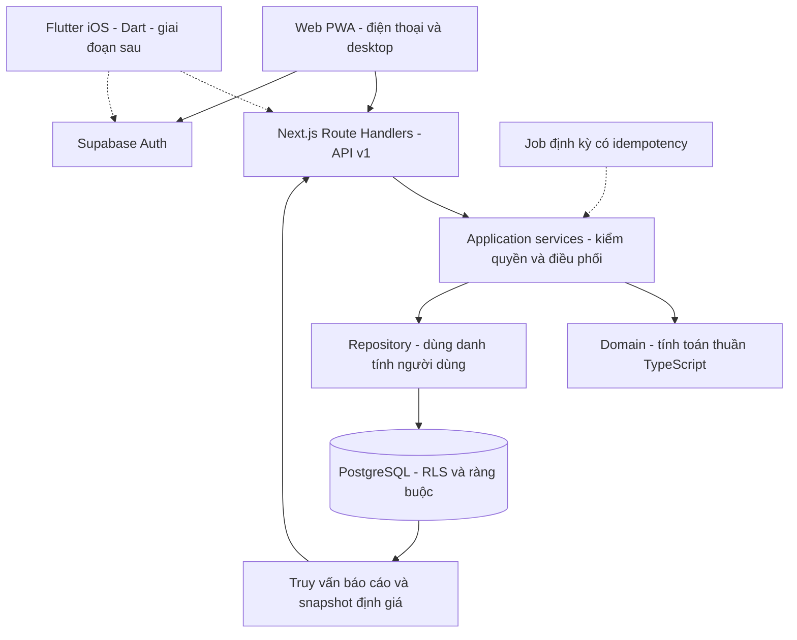

# Kiến trúc và công nghệ

**Hiện trạng 17/10/2026:** web Next.js có landing công khai, Auth email, API v1 cho Thu nhập/Chi tiêu/Tiết kiệm và migrations PostgreSQL/RLS. Các mô tả P0 và endpoint dự kiến bên dưới là nền định hướng lịch sử, không phải danh sách chức năng đang thiếu của ba module đã triển khai.

## Trang công khai và kiểm soát truy cập

- Root layout giữ font, token, user provider và PWA. Route group `(public)` chứa `/` và `/login`; `(app)` giữ URL hiện có với sidebar, Privacy Mode và metadata noindex.
- Mỗi page ứng dụng await `pageAccess()` trước khi render. `pageSession()` xác minh qua Supabase `getUser`, chỉ cache trong một lượt render; không dựa vào cookie claim hoặc layout để cấp quyền.
- Proxy refresh cookie cho trang và API, đặt private/no-store. Chỉ request API có Authorization mới bỏ qua refresh cookie; API tự xác minh Bearer và owner/RLS.
- Phiên thiếu/hết hạn chuyển `/login?next=...`; whitelist route dùng chung với catalog, mặc định `/overview`. Auth gián đoạn hiện retry, không coi là logout. `/` luôn công khai.
- Trang `/` vẫn công khai nhưng proxy refresh cookie và đặt `private, no-store`; root layout dùng `pageSession()` xác minh user, chia sẻ kết quả qua React cache trong cùng request với page guards/public layout. `UserProvider` khởi tạo bằng user đã xác minh, không chứa access/refresh token và không gọi lại getUser ngay sau hydration khi đã có user. `LandingAudience`, `PublicShell`, CTA và menu dùng cùng trạng thái từ HTML đầu tiên. Lỗi Auth không redirect/chặn nội dung `/`; provider vẫn cho thử lại phía trình duyệt. Ảnh Open Graph, robots và sitemap không refresh Auth. Đây là phân loại trình bày; mỗi workspace/API vẫn xác minh quyền độc lập. `marketing-shell` chỉ áp cho khách ở `/`, không đổi preferences hoặc giao diện login.
- Landing preview là client component với dữ liệu mẫu cố định; không import workspace hoặc gọi API tài chính. Tài khoản công khai dùng user provider/menu hiện có, tách khỏi dữ liệu preview.
- Metadata chia sẻ có ảnh Open Graph sinh bằng Next ImageResponse. App và login noindex; service worker chỉ cache offline.html, PWA mở /overview sau xác thực.
- Catalog là nguồn module/status dùng chung; tài liệu và preview được rà soát cùng thay đổi theo AGENTS.md. Xem [đặc tả landing](features/landing.md).

**Module Chi tiêu đã có source:** Supabase SSR/Auth, API v1, Zod, Postgres.js và transaction/RLS; native form/dialog, biểu đồ HTML/SVG, Vitest/Playwright. Connection server dùng role expense_api và JWT claims theo owner đã xác minh. Chi tiết triển khai và khác biệt so với các công nghệ còn dự kiến bên dưới nằm ở [đặc tả Chi tiêu](features/expenses.md). Mức xác minh cloud theo từng module được ghi riêng trong [validation](07-validation.md); migration Tiết kiệm chưa áp dụng trên cloud.

## Quyết định chính

Dùng một codebase web và backend theo module, tránh tách microservice ở quy mô cá nhân. Tách nghiệp vụ tài chính khỏi framework; cung cấp HTTP API có phiên bản để PWA và iOS dùng chung. Stack bên dưới phân biệt công nghệ đã dùng trong source và những lựa chọn chỉ bổ sung khi cần.

## Stack theo nhu cầu

| Lớp | Công nghệ | Lý do chọn | Trạng thái |
| --- | --- | --- | --- |
| Runtime | Node 22 LTS, npm + lockfile | Có runtime phù hợp sẵn trên máy; kiểm tra nhất quán local/CI/cloud | Đã dùng local |
| Web và API | Next.js App Router + React + TypeScript strict | Routing, rendering và HTTP API trong cùng source; dễ triển khai và tách service về sau | Đã triển khai landing, Auth và ba module |
| Styling | Tailwind CSS 4 + CSS semantic tokens | Giao diện responsive, theme và tái sử dụng style | Đã cài; shell dùng CSS tokens |
| Components | shadcn/ui, bổ sung khi có dialog/form/table thực tế | Sở hữu source component và chuẩn hóa hành vi truy cập | Chưa cài |
| Icon | Lucide React | Cùng một bộ SVG có nhãn đi kèm | Đã dùng |
| Forms | Native form/dialog + Zod | Schema kiểm tra client/server; chưa cần React Hook Form | Đã dùng |
| Biểu đồ/bảng | HTML/SVG và bảng có accessibility | Tương tác bàn phím, bảng thay thế, ít dependency | Đã dùng; Recharts/TanStack chưa cần |
| Số học | BigInt; số lượng vàng có scale cố định | Tránh mất chính xác từ float; API dùng decimal string | Đã triển khai |
| Database | PostgreSQL, Postgres.js và SQL migrations | Transaction, RLS và role expense_api | Source/local đã có; cloud theo module |
| Auth | Supabase Auth + `@supabase/ssr` cho web | Mã email 8 số, cookie refresh, page/API verification | Đã triển khai |
| Client dữ liệu | HTTP API v1 cho tài chính; Supabase SDK cho Auth | Server xác minh owner và áp RLS | Đã dùng |
| PWA | Manifest của Next.js + service worker giới hạn phạm vi | Bắt đầu nhẹ, offline fallback; hàng đợi offline bổ sung sau | Nền PWA đã dựng |
| Kiểm thử | Vitest, DB integration/RLS, Playwright | Kiểm công thức, transaction, quyền và tác vụ nhiều thiết bị | Unit, DB integration/RLS và browser local đã có |
| Deploy | Vercel + Supabase managed | Hạn chế việc tự vận hành server; preview riêng với production | Mới là kế hoạch |

Khóa phiên bản thực tế trong `package-lock.json`. Dùng TypeScript 5.9 cho bộ khung hiện tại; không tự động chuyển major theo npm latest. Các dependency chưa cần thiết được để ở trạng thái dự kiến.

## Ranh giới source khi mở rộng

Refactor 28/10/2026 giữ kiến trúc phân lớp và mọi HTTP/schema hiện có. Năm editor tách config, dựng action, hook điều phối, trường nhập và preview; workspace tách hook dữ liệu khỏi JSX. Validation/Clock/ngày/tiền dùng primitive trung lập; CSV có bản dịch nằm ở `i18n/report-exports`. Tiết kiệm/Đầu tư tách model, replay và command nhưng giữ entrypoint engine. Fingerprint command giữ thuật toán cũ; fingerprint backup độc lập. HTTP transport và thiết lập transaction/RLS dùng chung qua adapter của từng module, giữ thông báo, lỗi, kiểm migration và thứ tự khóa. Native dialog nằm ở components, alias ExpenseModal vẫn tương thích. Các phần của stylesheet experience được import theo thứ tự cascade cũ.

Lint, kiểm tra import/cycle/client-server và định dạng là một phần của `npm run check` trong local/CI. Hướng dẫn trách nhiệm từng lớp, cấu trúc editor, ngoại lệ vòng đời và checklist thêm module nằm trong [bảo trì source](11-source-maintenance.md). Bằng chứng local theo đợt nằm trong [validation](07-validation.md); refactor không áp migration, đổi dữ liệu hoặc xác minh deployment.

Tiết kiệm có `ledger-tables.tsx` (27/10/2026) dùng chung bảng giao dịch tháng và giao dịch nguồn báo cáo; workspace truyền giao dịch đã lọc cùng effects tương ứng. Bảng danh mục tra rule theo tháng đang xem, tên danh mục giao dịch tra theo ngày giao dịch. `ColumnTable` giữ cấu hình cột riêng trên trình duyệt, CSS container query chọn bố cục theo vùng nội dung. Không thêm request, thay đổi domain/schema hay quyền truy cập cho thay đổi bố cục này.

- `src/app`: route web và `/api/v1`, chỉ chuyển request/response, không chứa công thức tài chính trong JSX.
- `src/features/<feature>`: component, form và view model của mỗi module.
- `src/domain`: kiểu và hàm thuần phía TypeScript; không import React/Next/Supabase/browser. Flutter sử dụng kết quả qua API, không import TypeScript trực tiếp.
- `src/application`: use case như `recordExpense`, `transferFunds`, `executeTrade`, kiểm quyền, idempotency và transaction boundary.
- `src/server`: session, repository và adapter DB; chỉ server được import.
- `supabase/migrations`: SQL có phiên bản, RLS, constraints và RPC nguyên tử.
- `tests`: bổ sung theo nghiệp vụ; dữ liệu giả, không dùng tài chính thật.

Trang `[module]` giữ bản đồ phạm vi cho module chưa triển khai; vẫn yêu cầu đăng nhập. Thu nhập, Chi tiêu và Tiết kiệm có route, domain, API và migrations riêng; quy tắc module còn lại tiếp tục được làm rõ theo đặc tả.

## Ghi dữ liệu và API cho iOS

Đề xuất `/api/v1/accounts`, `/transactions`, `/budgets`, `/goals`, `/trades`, `/valuations`, `/reports` và `/imports`. Đây là các hợp đồng mở rộng dự kiến. Hiện đã có `/api/v1/income`, `/api/v1/expenses`, `/api/v1/savings`, `/api/v1/investments` và `/api/v1/funds`; các module có preview/commands, báo cáo tùy module. Viết OpenAPI/schema request-response trước khi app iOS dùng API.

Web dùng session cookie được xác minh phía server; native về sau dùng bearer access token đã kiểm chứng issuer/audience/expiry. Không tin `owner_id` từ request. Mọi use case lấy chủ sở hữu từ danh tính đã xác thực, kiểm quan hệ tài khoản/tài sản thuộc cùng chủ.

Lệnh thay đổi tiền có idempotency key, payload fingerprint và version. Gửi lại cùng key/cùng payload trả lại kết quả cũ; cùng key/khác payload báo xung đột. Ghi nhiều bảng phải đi qua **một DB transaction/RPC**; không gọi nhiều request Supabase độc lập rồi hy vọng tất cả cùng thành công. Không dùng service-role key cho request tài chính thông thường.

React Server Components có thể đọc trực tiếp qua application service khi đã kiểm quyền. Server Actions nếu dùng chỉ là adapter mỏng; các nghiệp vụ cần cho iOS luôn có API HTTP tương ứng. Không để iOS phụ thuộc giao thức Server Actions của web.

## Đồng bộ

P1: server là nguồn dữ liệu chuẩn; sau lệnh thành công thì refetch. Thiết bị khác cập nhật khi mở lại trang và refresh. Tổng quan/Chi tiêu/Thu nhập cập nhật ngầm khi quay lại foreground nếu lần tải thành công đã qua 60 giây; có mạng trở lại hoặc đổi ngày Asia/Ho_Chi_Minh được kiểm tra sớm hơn, với khoảng cách tối thiểu 5 giây giữa các lần tải tự động. Các sự kiện focus/visibilitychange/online dùng chung bộ điều phối riêng cho mỗi view, không tải trùng khi còn request. Lưu, thử lại, đổi năm Thu nhập và timer qua ngày vẫn đọc server ngay; nếu cần cập nhật tức thời, thêm Realtime có lọc quyền. Không coi việc bật Realtime là đã giải quyết xung đột.

P5: bản nháp/offline command có UUID, trạng thái chờ/đã gửi/thất bại, retry có idempotency; version ngăn ghi đè sửa đổi trên thiết bị khác. Xung đột phải cho người dùng chọn hoặc sửa lại, không âm thầm last-write-wins với tiền. Xóa cache dữ liệu riêng khi đăng xuất; xử lý cả khi token hết hạn, thiết bị offline hoặc người dùng đổi tài khoản.

## Hướng app iOS

Theo định hướng bổ sung ngày 15/10/2026: **dùng Flutter/Dart cho app iOS cá nhân**, không đặt mục tiêu phát hành App Store. Flutter là client riêng, dùng cùng HTTP API, Supabase Auth và database với web. Supabase có [SDK Flutter/Dart chính thức](https://supabase.com/docs/reference/dart/introduction).

Điểm cần điều chỉnh so với đề xuất React Native ban đầu: Flutter không dùng lại trực tiếp React components, TypeScript domain hoặc TypeScript API client. Phép tính tài chính và kiểm quyền được thực hiện tập trung trên backend; web/Flutter gọi API và hiển thị kết quả. Dart có model, form và client riêng; tiền/số lượng tiếp tục truyền bằng decimal string, không chuyển tiền sang double để tính.

Hợp đồng dùng chung là OpenAPI/JSON Schema và các kịch bản đầu vào/kết quả mong muốn; có thể sinh Dart client và TypeScript client từ cùng đặc tả. Kiểm tra đầu vào trên client giúp nhập liệu, nhưng server luôn xác thực và tính lại. Offline queue có triển khai riêng cho từng nền tảng, dùng chung quy tắc idempotency/version.

Khi bắt đầu native mới cân nhắc cấu trúc `apps/web`, `apps/mobile` (Flutter), `packages/api-contract`, và phần domain backend. Flutter dùng pub và Flutter toolchain riêng; không giả định npm build sẽ build luôn app iOS. Hiện giữ một app web gọn, chưa cài Flutter/Xcode hoặc tạo app mobile.

Để cài trực tiếp lên iPhone, cần Mac + Xcode, signing và thiết bị thật theo [Flutter iOS setup](https://docs.flutter.dev/platform-integration/ios/setup). Personal Team miễn phí cần ký/cài lại khi provisioning profile hết hạn sau 7 ngày; Developer Program trả phí hỗ trợ thêm cách phân phối. Các phương án và giới hạn được ghi trong [Deploy — cài trên iPhone](05-deployment.md#cài-trên-iphone-cá-nhân).

## Lựa chọn khác

| Phương án | Khi phù hợp | Đánh đổi |
| --- | --- | --- |
| Vite/React + API backend riêng | Đã có backend hoặc cần hai vòng release độc lập | Cần vận hành và cấu hình thêm một dịch vụ |
| Next.js + Postgres tự host | Người dùng ưu tiên quản trị hạ tầng | Tự lo TLS, cập nhật, Auth, backup, monitoring |
| IndexedDB/local-only | Chỉ một máy, ưu tiên dữ liệu không rời thiết bị | Không phù hợp lựa chọn cloud/đồng bộ đã xác nhận |

## Tài liệu kỹ thuật đã đối chiếu

- [Next.js installation](https://nextjs.org/docs/app/getting-started/installation): App Router, TypeScript và yêu cầu runtime.
- [Next.js PWA](https://nextjs.org/docs/app/guides/progressive-web-apps): manifest và service worker; đây là nền cho PWA trong source.
- [Supabase SSR](https://supabase.com/docs/guides/auth/server-side/nextjs): cấu hình client/server cho session web khi triển khai Auth.
- [Supabase RLS](https://supabase.com/docs/guides/database/postgres/row-level-security): kiểm soát truy cập trong PostgreSQL, cần kết hợp grants/policies và kiểm thử.
- [PostgreSQL numeric types](https://www.postgresql.org/docs/current/datatype-numeric.html): dùng kiểu số chính xác cho tiền/số lượng theo schema.
- [shadcn/ui với Next.js](https://ui.shadcn.com/docs/installation/next): hướng tích hợp component khi bắt đầu form/dialog.

## Đầu tư — 18/10/2026

Đầu tư có domain/application/repository/API/UI riêng, theo tổng danh mục VND và nhiều ví tiền chờ. Dùng lại cơ chế Auth, RLS, preview, advisory lock, version và idempotency của các module hiện có; không dùng engine vàng/sổ tiền gửi cho danh mục tổng tiền. Mua/bán là một command cập nhật vốn, định giá và ví trong cùng transaction. Sáu bảng mới giữ metadata có ngày, revisions giao dịch/định giá, audit và command; không có tháng chốt. Trang await kiểm tra truy cập server. Chi tiết [Đầu tư](features/investments.md).

Không tự nối số dư với các module khác hoặc tạo báo cáo tài sản ròng toàn ứng dụng. Migration cloud và kiểm chứng thiết bị thật là bước riêng.

## Bổ sung backup toàn tài khoản — 18/10/2026

API `/api/v1/data` và repository riêng đọc snapshot nhất quán, dùng runtime RLS hiện có. Import khóa bốn module theo thứ tự cố định, kiểm tra tài khoản trống sau khóa, ghi và đối soát trong một transaction kèm biên nhận idempotency. Hồ sơ Auth cập nhật riêng sau commit; xem [backup](features/backup.md).

### Rà soát tải backup và Cài đặt — 18/10/2026

Tách readiness của dữ liệu tài chính khỏi readiness của biên nhận import: export/status không đòi `data_imports`, status thêm `importReady`; chỉ import đòi migration biên nhận. Không giảm kiểm tra đầy đủ 28 bảng hoặc RLS. Xem đặc tả backup.

## Quỹ an toàn — 19/10/2026

Fund dùng domain/application/repository/API riêng tại `/api/v1/funds`; page chờ `pageAccess`. Command version/idempotency, RLS owner, lịch sử append-only. Đọc nguồn Chi tiêu trong cùng transaction và khóa Expenses → Fund. GET không khởi tạo dữ liệu. Client refetch khi foreground bằng helper hiện tại; không lưu tài chính trên thiết bị.

## Thành phần trải nghiệm dùng chung — 19/10/2026

Theme được áp dụng bằng script cố định trước first paint và đồng bộ qua storage/media events; HTML suppressHydrationWarning chỉ giới hạn ở thuộc tính root được script quản lý. Sidebar và cột bảng dùng storage chỉ cho UI preferences, không lưu bản nháp hay số tiền. Tooltip dùng chung giữ key điểm được chọn, format từ dữ liệu hiện hành để tránh lộ tiền sau toggle. Metadata logo dùng cột nullable riêng với RLS/command/version hiện có; xem [quy chuẩn](features/interface-feedback-2026-10-19.md).

## Tương thích schema logo Chi tiêu — 20/10/2026

Repository Chi tiêu đọc `brand_key`/`icon_key` bằng `to_jsonb` của hàng để cột metadata còn thiếu trở thành null. Khi lưu có phân loại, kiểm tra đủ hai cột qua `information_schema.columns` trong cùng transaction: schema cũ lưu các trường cũ; yêu cầu metadata khác null trả `LABEL_VISUALS_MIGRATION_REQUIRED` trước mọi ghi. Không nuốt lỗi SQL khác, không tự migrate, không đổi RLS/version/idempotency. Adapter dùng chung cho nguồn Fund hưởng cùng khả năng đọc tương thích; backup/import vẫn có yêu cầu schema riêng.

Bổ sung 29/10/2026: repository backup cũng đọc hai cột tùy chọn qua `to_jsonb`, giữ snapshot repeatable-read/read-only và đầy đủ 35 bảng của V2. Import kiểm tra từng cột trong transaction sau khóa/kiểm tra đích trống; bỏ cột còn thiếu chỉ khi giá trị của tất cả nhãn là null. Metadata khác null trên cột chưa tồn tại bị từ chối bằng `SCHEMA_NOT_READY` trước mọi INSERT; đối soát read-back và biên nhận vẫn giữ nguyên. Không tự chạy DDL hoặc mở rộng fallback sang trường nghiệp vụ.

## Help theo trang — 20/10/2026

`src/features/help/` quản lý nội dung TypeScript, registry và controller `openHelp(pageId, sectionId?)`. Registry lấy tên/trạng thái từ catalog, thêm Hồ sơ; controller nằm bên trong SessionBoundary. Nội dung tải bằng dynamic import khi mở, có trạng thái tải/lỗi/thử lại, không gọi API tài chính. Route đổi hoặc session boundary gỡ nội dung sẽ đóng Help. Không thêm API, schema, migration hoặc lưu trạng thái Help vào storage.

Help dùng biến thể `help` của dialog chung, giữ cùng stack/inert, khóa cuộn và phục hồi focus khi mở trên form/dialog con. Trang private vẫn tự await pageAccess; public preview chỉ dùng nội dung minh họa cố định độc lập. Xem [đặc tả Help](features/help.md).

### Tinh chỉnh trình đọc Help — 20/10/2026

`HelpPageTitle` gắn nút theo pathname cạnh h1 của từng workspace và trang planned; không phụ thuộc tải dữ liệu nghiệp vụ. `HelpText` chỉ xử lý dấu nhấn biên tập thành React strong, giữ escape mặc định. Biến thể Help của ExpenseModal trì hoãn unmount khi đóng đến animationend hoặc timeout 300ms, dọn timer khi đổi route/unmount; các dialog khác giữ hành vi hiện có.

## Chủ đề độc lập với chế độ hiển thị — 21/10/2026

Danh sách `visualThemeKeys` dùng chung cho bộ chọn, kiểm tra giá trị và script trước paint; cấu hình `visualThemes` định nghĩa `VisualTheme = forest | water | gold | fire | earth`, màu thanh trình duyệt và lời dẫn. `fm-visual-theme` điều khiển `data-visual-theme`; `fm-theme` vẫn giữ light/dark/system để tương thích. PreferenceSync đọc snapshot hiện tại khi hydrate, script parser áp dụng lựa chọn trước lần vẽ đầu. CSS chọn các nhánh SVG/text cùng markup server/client, không remount workspace hay gọi API. Metadata theme-color do React quản lý; system mode dùng media theo color-scheme.

Tùy chọn lưu theo origin trình duyệt, dùng storage event để cập nhật các tab và sự kiện nội bộ cho cùng tab. Storage bị chặn thì giữ trong bộ nhớ phiên của tab. Không thêm cookie, API, migration hay dữ liệu vào backup. Offline HTML độc lập đọc cùng hai khóa; service worker v6 chỉ cache trang này, không cache tài khoản/API. Manifest và biểu tượng cài đặt giữ nhận diện thương hiệu cố định. Xem [themes](features/themes.md).

## Popover chọn cột — 21/10/2026

`ColumnPicker` dùng Popover API (`popover="auto"`, invoker `popoverTarget`) để giữ DOM trong đúng dialog/section mà vẫn nằm trên top layer, tránh clipping bởi overflow của bảng. Tọa độ fixed được tính theo nút mở, giới hạn viewport và cập nhật khi scroll/resize; danh sách bên trong có vùng cuộn riêng. Không portal sang body ngoài dialog đang modal. Trạng thái cột vẫn dùng `usePreference`; `ColumnTable.showColumnPicker=false` cho phép đặt nút bên ngoài bảng mà giữ cùng cơ chế lọc header/body/footer. Escape được xử lý ở popover để không lan sang dialog cha.

## Locale trong app — 22/10/2026

Layout app đọc cookie `fm-locale` bằng async `cookies()` và cung cấp cho `LocaleProvider`; từng page vẫn await kiểm tra quyền server. UI là `AppShell` client và các workspace giữ state qua context. Từ điển TypeScript tách module, có namespace; Help tiếng Anh tải khi mở. Formatter/parser nhận locale, giữ tiền nguyên/số lượng dạng chuẩn. API lỗi thêm metadata dịch tương thích; CSV nhận `locale`, JSON/backup không đổi. Không thêm bảng hoặc migration. Xem [ngôn ngữ và logo](features/localization.md).

## Vùng cuộn bảng và thanh tab — 23/10/2026

`ColumnTable` sở hữu `.column-table-scroll` nằm cạnh toolbar, nhận `scrollClassName` và `scrollLabel`; fallback nhãn lấy từ caption hoặc chuỗi Bảng dữ liệu đã dịch. Props của table và khóa `tableId` vẫn giữ nguyên. Các khung module chỉ giữ trình bày, không tạo thêm scroller. `ScrollTabs` giữ semantics của div/nav, dùng MutationObserver/ResizeObserver để đưa mục được chọn vào vùng nhìn thấy bằng cuộn ngang nội bộ, ưu tiên nút đang focus khi điều hướng bàn phím và cập nhật theo kích thước các nhãn sau đổi ngôn ngữ. Không sửa API tài chính hay schema. Xem [quy chuẩn UI](features/ui-feedback.md).

### Đăng nhập email OTP — 27/10/2026

Luồng email → mã 8 số → verifyOtp tạo phiên, mục tiêu thời hạn 1.800 giây; Supabase thực thi thời hạn/rate limit, UI chờ gửi lại 60 giây. Callback PKCE giữ cho link cũ. Không đổi API tài chính/schema/chính sách đăng ký; server page guard và RLS giữ nguyên. Template cloud phải dùng Token cho cả login và signup hiện có. Xem [đặc tả OTP](features/email-otp.md); cấu hình cloud và email thật cần nghiệm thu riêng.

### SEO công khai — 27/10/2026

`src/lib/seo.ts` đọc cấu hình server và dùng tóm tắt sản phẩm từ catalog để tạo metadata/JSON-LD cho trang chủ. Root layout mặc định noindex; riêng `/` có thể override khi `SEO_INDEXABLE=true`, origin HTTPS công khai hợp lệ và môi trường production phù hợp. Không dùng request Host để suy ra canonical; không ảnh hưởng `publicOrigin`/same-origin của Auth/API. Canonical chỉ thuộc homepage, không kế thừa sang login hoặc workspace.

Robots/sitemap là metadata route tĩnh của Next.js, dùng cùng điều kiện index với HTML và cần build lại sau đổi môi trường. Proxy trả qua hai endpoint trước bước refresh Auth. Sitemap chỉ liệt kê `/`; robots không chặn HTML/tài nguyên render để crawler đọc noindex. Server page guard và RLS vẫn chịu trách nhiệm bảo vệ tài khoản. Xem [đặc tả landing](features/landing.md#seo-trang-giới-thiệu--27102026).

UI OTP dùng 8 input có nhãn truy cập riêng, giữ từng vị trí khi xóa/sửa. Thao tác hoàn thành truyền trực tiếp chuỗi mã mới cho verifyOtp để tránh state React chưa cập nhật; khóa request đồng bộ chặn xác nhận trùng khi auto-submit/Enter/paste trùng nhau. Không xác nhận bằng effect theo state để tránh vòng lặp sau lỗi.

## Ngôn ngữ trang công khai — 27/10/2026

Layout công khai đọc `serverLocaleState()`, bọc một `LocaleProvider` và `ToastProvider` quanh `PublicChrome`; trang login dùng provider này thay cho provider riêng. Hai landing và preview là client components được SSR theo cookie, đổi ngôn ngữ bằng context và giữ state. Root HTML đọc locale server; provider cập nhật document lang/title phía client. SEO helpers nhận locale tùy chọn, mặc định vi, giữ canonical và indexing gate. Không đổi API, schema hoặc kiểm tra quyền server.

## Ghi dữ liệu thay đổi — 28/10/2026

Năm repository Chi tiêu, Thu nhập, Tiết kiệm, Đầu tư và Quỹ lưu snapshot độc lập sau `read()` trong transaction. `changedRecords` so sánh theo khóa ổn định và nội dung để chỉ upsert dòng mới/đã sửa; không giữ snapshot giữa request hoặc giữa owner. Các vòng ghi revision/giá/chốt/configuration cũ được bỏ qua, vẫn giữ toàn bộ dữ liệu khi tính nghiệp vụ. Chi tiêu chỉ kiểm migration metadata khi thực sự ghi phân loại; chỉ đối soát xóa phân loại khi danh sách bị bỏ mục. Khóa owner, version, RLS, rollback và idempotency giữ nguyên. GET vẫn đọc sổ đầy đủ; không có cache tài chính dùng chung. Xem [rà soát](features/expense-feedback-2026-10-28.md).

## Thành phần phản hồi dùng chung — 28/10/2026

`RequiredFieldsNote` tập trung chú thích bắt buộc và bản dịch cho đăng nhập, hồ sơ cùng năm editor. `ToastProvider` giữ success/error/warning và vị trí trong dialog đang hoạt động; `ToastViewport` có vùng riêng giữa header và body của native dialog; trình bày icon, tiêu đề, nội dung và trạng thái đọc để tạm dừng timeout thành công. CSS dùng token theme hiện có, không thêm thư viện hoặc thay đổi API/quy tắc ghi dữ liệu.

## Emoji Chi tiêu và danh sách phân loại — 28/10/2026

`isJarEmoji` dùng Unicode RGI để kiểm tra một emoji đơn hoặc ghép, loại văn bản/nhiều emoji và modifier đứng riêng. `jarEmojiSchema` dùng chung cho command và backup rules/snapshot; `JarEmoji` là chuỗi được kiểm tra ở ranh giới, bộ gợi ý không còn là enum giới hạn dữ liệu. Metadata tiếp tục lưu JSONB theo tháng, không thay tính tiền và không cần migration. `DialogList.renderItem` thêm cách trình bày danh sách gọn, tái dùng tìm kiếm/phân trang và giữ nguyên đường render bảng mặc định. Logo thương hiệu mở rộng vẫn là asset tĩnh cùng provenance, không gọi ngân hàng.

## Thành phần trải nghiệm dùng chung — 28/10/2026

MonthYearSelect sở hữu trình bày kỳ YYYY-MM, MobileNavigation sở hữu đóng menu, Modal sở hữu dialog stack và vùng hiển thị. Typography dùng token rem theo vai trò; lỗi hạ tầng được chuyển thành nội dung phổ thông ở client, giữ hợp đồng HTTP. Xem [quy tắc và phạm vi](features/usability-consistency-2026-10-28.md).

## Responsive và nội dung phổ thông — 29/10/2026

`AnimatedDetails` là client primitive dùng DOM native, chỉ bổ sung chuyển động; không thay ranh giới server/Auth hoặc API. Preview mobile dùng CSS responsive và trạng thái minh họa hiện có. Xem [quy tắc và kiểm chứng](features/responsive-disclosures-2026-10-29.md).

## Tổng quan đa module — 29/10/2026

Feature Tổng quan riêng thay route sử dụng ExpenseOverview. GET `/api/v1/overview` dùng application readers/domain summaries, chỉ trả DTO các nguồn cần dùng, lỗi nguồn độc lập, private/no-store. GET/PUT `/api/v1/overview/layout` dùng `overview_layouts`, FORCE RLS, khóa owner và revision để tránh ghi đè. Config display nằm ngoài backup tài chính và account emptiness. Giữ pageAccess và Auth/origin hiện có. Đọc nguồn độc lập, không cam kết snapshot toàn ứng dụng. Xem [đặc tả](features/overview.md).
